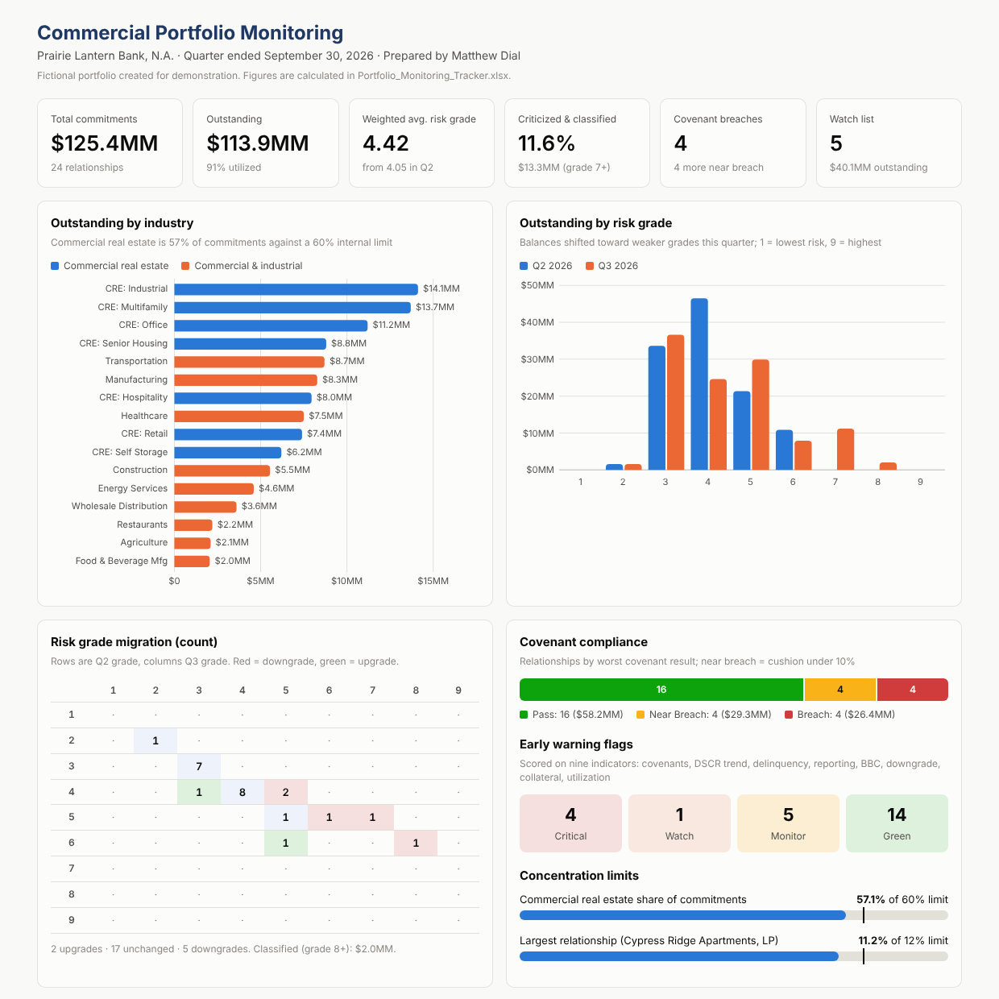

# 02 | Portfolio Monitoring: $125MM Commercial Portfolio

Quarterly monitoring for a fictional 24-relationship commercial loan portfolio: covenant testing, early warning scoring, a self-building watch list, risk grade migration, concentration limits, and reporting tracking. Brazos Bend Fabrication from [Package 01](../01-commercial-credit-package/) appears here as loan PL-1001.

> **Fictional work sample.** The bank (Prairie Lantern Bank, N.A.), every borrower, and all figures were created for demonstration. No real customer or employer data is used.

## Q3 2026 at a glance

| Metric | Result |
|---|---|
| Commitments / outstanding | $125.4MM / $113.9MM |
| Weighted average risk grade | 4.42 (from 4.05) |
| Criticized + classified | $13.3MM, 11.6% of outstanding |
| Covenant breaches | 4 relationships, $26.4MM |
| Watch list | 5 relationships, $40.1MM |
| CRE concentration | 57.1% of commitments vs. 60% limit |

## Files

| File | What it is |
|---|---|
| [Portfolio_Monitoring_Tracker.xlsx](Portfolio_Monitoring_Tracker.xlsx) | Formula-driven tracker (9 tabs, 1,600+ formulas). Update the loan register and everything recalculates. |
| [Portfolio_Dashboard.html](Portfolio_Dashboard.html) | Interactive dashboard: hover tooltips, sortable and filterable loan table, light and dark mode |
| [Q3_2026_Portfolio_Review.md](Q3_2026_Portfolio_Review.md) | Quarterly review memo with watch list action plans and recommendations |

## Inside the tracker

| Tab | What it does |
|---|---|
| **Settings** | As-of date, early warning thresholds and point values, concentration limits. Change a threshold and every flag updates. |
| **Loan_Register** | One row per relationship: exposure, grades, payment status, two covenants each, reporting dates, officer action plans |
| **Covenant_Test** | Calculates cushion for min and max covenants (DSCR, leverage, LTV, liquidity) and flags Pass / Near Breach / Breach |
| **Early_Warning** | Scores nine indicators per loan and assigns Critical / Watch / Monitor / Green |
| **Watch_List** | Builds itself: pulls every loan at or above the watch threshold, ranked by score, with action plans |
| **Grade_Migration** | Prior vs. current grade matrix by count and balance; criticized and classified totals |
| **Concentration** | Sector and industry exposure against limits; top five relationships |
| **Reporting_Tickler** | Financial statement and borrowing base status, days late, maturities in the next 12 months |

## Early warning scorecard

| Indicator | Points |
|---|---|
| Covenant breach | 3 |
| Covenant near breach (cushion under 10%) | 1 |
| DSCR decline of 15%+ vs. prior test | 2 |
| 30+ days past due | 3 |
| 15 to 29 days past due | 1 |
| Financial statements late | 1 |
| Borrowing base certificate older than 45 days | 1 |
| Risk grade downgrade | 2 |
| Collateral coverage below 1.00x | 2 |
| Revolver utilization above 90% | 1 |

**Flag levels:** Critical 5+, Watch 3 to 4, Monitor 1 to 2, Green 0.

## Design choices worth noting

- **The watch list is formula-driven, not filtered by hand.** A rank formula orders flagged loans by score, and INDEX/MATCH pulls them in, so the list rebuilds the moment a test result changes.
- **Covenant direction is explicit.** Each covenant is tagged Max or Min so leverage and LTV (lower is better) and DSCR and liquidity (higher is better) use the right cushion math.
- **Grade migration holds balances constant** across quarters so the change reflects grade movement, not paydowns.
- **Near-breach loans are flagged even when they pass**, because by the time a covenant breaks it is late to act.
