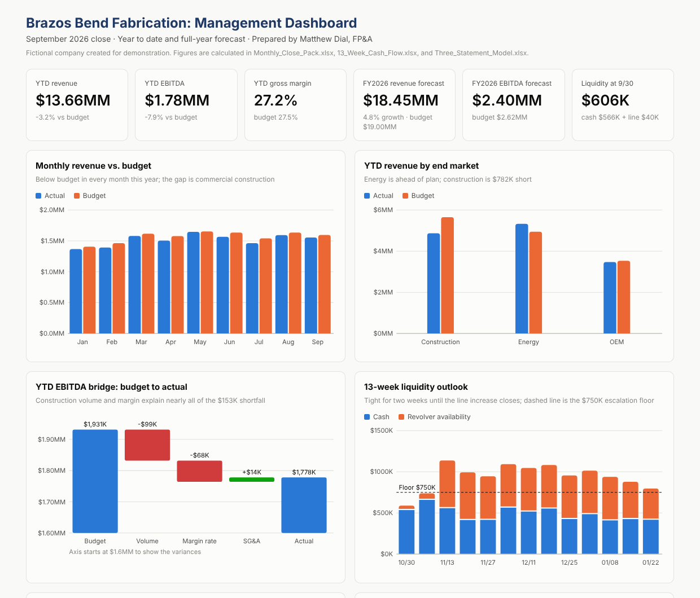

# 03 | FP&A and Treasury: Brazos Bend Fabrication

The same company from [Package 01](../01-commercial-credit-package/), seen from the inside. This package is the work an FP&A or treasury analyst does for a middle-market company: close the month, explain the variance, forecast the year, manage weekly cash, and model the next three years against the bank's covenants.

> **Fictional work sample.** Brazos Bend Fabrication and all figures were created for demonstration. No real company or employer data is used.



## September 2026 at a glance

| Metric | Result |
|---|---|
| YTD revenue vs. budget | $13.66MM, 3.2% below |
| YTD EBITDA vs. budget | $1.78MM, 7.9% below |
| FY2026 forecast | $18.45MM revenue, $2.40MM EBITDA |
| Reconciled cash, 9/30 | $566,427.25 |
| 13-week liquidity low point | $574K (week of 10/30), recovers after line increase |
| Base case FY2027 DSCR | 1.87x vs. 1.25x covenant |

## Files

| File | What it is |
|---|---|
| [Monthly_Close_Pack.xlsx](Monthly_Close_Pack.xlsx) | Budget vs. actual (month and YTD), volume vs. margin bridge, full-year forecast, bank reconciliation with transaction matching, KPI trends |
| [13_Week_Cash_Flow.xlsx](13_Week_Cash_Flow.xlsx) | Weekly cash forecast with a collection curve, payment lags, revolver draw and sweep logic, and borrowing base |
| [Three_Statement_Model.xlsx](Three_Statement_Model.xlsx) | Integrated income statement, balance sheet, and cash flow, FY2023A to FY2029P, with Base / Upside / Downside scenarios and covenant tests |
| [Management_Dashboard.html](Management_Dashboard.html) | Interactive dashboard: revenue vs. budget, EBITDA bridge, 13-week liquidity, working capital, KPIs |
| [September_2026_Management_Report.md](September_2026_Management_Report.md) | Month-end report to ownership with variance explanations and recommended actions |

## How the pieces connect

```
Monthly_Close_Pack  ──  FY2026 forecast  ──►  Three_Statement_Model (FY2026E)
        │                                              │
   9/30 cash, revolver,                     covenants use the same
   AR, billings                             definitions as the Package 01 memo
        │
        ▼
13_Week_Cash_Flow  ──  equipment deposit and loan funding match the Package 01 sources and uses
```

- The September revolver balance ($960K) and term loan balance ($1.42MM) match loan PL-1001 in [Package 02](../02-portfolio-monitoring/).
- The September revolver availability ($40K) is the opening point of the 13-week forecast, which is why the line increase matters.

## What each workbook demonstrates

**Monthly close pack**
- Favorable / unfavorable logic that flips correctly for revenue vs. cost lines
- Gross profit variance split into **volume** (revenue change at budget margin) and **rate** (margin change on actual revenue), with a check that they sum to the total
- Bank reconciliation where every transaction is matched automatically on reference and amount; unmatched items must be classified, and the rec must tie to zero
- Proposed adjusting journal entries generated from the reconciling items

**13-week cash flow**
- Collections modeled from a lag curve over nine weeks of billing history, not a flat percentage
- Materials payments lagged to match DPO; payroll, rent, and debt service on their actual calendars
- Revolver draws to protect minimum cash and sweeps excess, limited by the lesser of commitment and borrowing base, in $25K increments
- Liquidity floor test that flags the weeks needing CFO attention

**Three-statement model**
- Fully integrated statements that balance in every year, with a cash proof
- Revolver as the balancing item, with interest on beginning balances to avoid circular references
- New equipment loan amortized with exact monthly principal and interest (CUMPRINC / CUMIPMT)
- Scenario selector driving every assumption, plus a side-by-side comparison tab
- Covenant tests and the distribution restriction from the Package 01 credit memo

## A finding worth discussing in an interview

The downside case (revenue down 15%) still passes the 1.25x DSCR covenant, which looks surprising next to the Package 01 stress test. The reason: as a pass-through entity, distributions fall when income falls, so cash available for debt service holds up better than EBITDA does. The covenant passes, but the distribution restriction trips for two years, and the owners would feel the downturn in their personal cash flow rather than the bank feeling it in coverage.
