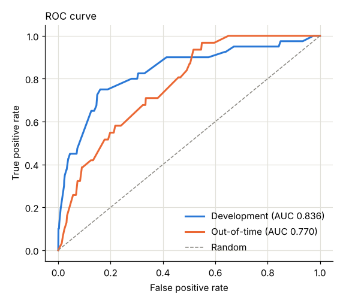
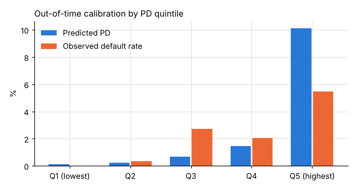
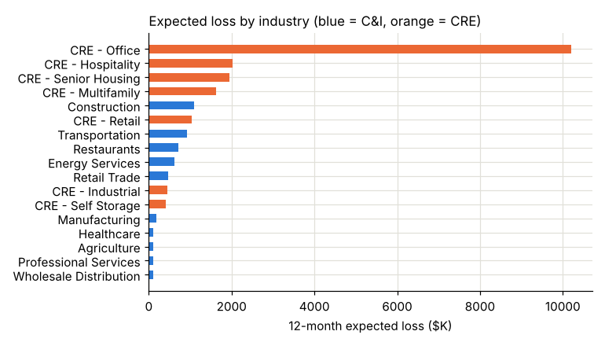

# Model Development Document: Commercial PD Scorecard v1.0

**Prairie Lantern Bank, N.A. | Commercial & CRE | Prepared by Matthew Dial | October 2026**

> Portfolio work sample. All data is synthetic, generated by [`data/generate_data.py`](data/generate_data.py). The structure follows the kind of documentation model risk management teams expect (purpose, data, methodology, performance, limitations, monitoring).

---

## 1. Purpose and use

| | |
|---|---|
| **What it estimates** | Probability that a commercial or CRE borrower defaults (90+ days past due or nonaccrual) in the next 12 months |
| **Population** | All commercial borrowers with annual financial statements: 10 C&I industries and 7 CRE property types |
| **Intended uses** | Challenger to officer risk grades; early warning when new statements arrive; input to portfolio expected loss |
| **Not intended for** | Loan pricing, regulatory capital, or CECL reserves without recalibration to a through-the-cycle view |
| **Model type** | Logistic regression on Weight of Evidence (WoE) variables, scaled to a points-based scorecard |

---

## 2. Data

**Source:** `prairie_lantern_loans.db`, tables `financials`, `borrowers`, and `defaults`. The modeling query is in the notebook, section 1.

| Sample | Fiscal years | Outcome window | Observations | Defaults | Default rate |
|---|---|---|---|---|---|
| Development | FY2022 to FY2023 | 2023 to 2024 | 2,633 | 40 | 1.52% |
| Out-of-time (OOT) | FY2024 | 2025 | 1,460 | 31 | 2.12% |
| Scoring | FY2025 | 2026 (through 9/30) | 1,429 | 34 so far | n/a |

**Default definition:** first date a loan reaches 90+ days past due or is placed on nonaccrual. Borrower-level: any loan defaulting counts.

**Exclusions:** none at the borrower level. Borrowers stop contributing observations after they default.

**Data quality checks performed:** one statement per borrower per year (primary key), no missing DSCR, sector-specific ratios populated only for the correct sector, defaults matched to an active loan.

**Known data limitation:** only 71 defaults across development and OOT. Commercial books are low-default portfolios, so every estimate carries wide confidence intervals.

---

## 3. Methodology

### 3.1 Candidate variables

| Variable | Applies to | Rationale |
|---|---|---|
| DSCR | All | Primary repayment capacity |
| DSCR change vs. prior year | All | Deteriorating trend |
| Funded debt / EBITDA | C&I | Leverage |
| Current ratio | C&I | Liquidity |
| Loan to value | CRE | Collateral cushion |
| Industry risk tier (High / Medium / Low) | All | Sector risk; judgmental tiers, since single industries have too few defaults |
| Years in business | All | Management experience and survival |
| Personal guaranty | All | Secondary support and alignment |

### 3.2 Binning and WoE

Variables were binned on the development sample, starting with finer cuts and merging neighbors until default rates moved in one direction. WoE = ln(% of defaults in bin / % of non-defaults in bin), with 0.5 added to each count to stabilize sparse bins.

**Design decision:** sector-specific ratios are binned only within their own sector, and borrowers they don't apply to get a neutral WoE of 0. An earlier version gave them their own "N/A" bin, which turned leverage and current ratio into a hidden sector flag (correlation of 0.91 between the two WoE variables).

### 3.3 Variable selection

| Variable | IV | Decision | Reason |
|---|---|---|---|
| DSCR | 1.10 | **Kept** | Strong, monotonic |
| Loan to value | 0.85 | **Kept** | Strong, monotonic |
| Industry risk tier | 0.77 | **Kept** | Strong |
| DSCR change | 0.41 | Dropped | Not significant once DSCR is in the model (p = 0.53); correlated with DSCR |
| Funded debt / EBITDA | 0.01 | Dropped | IV below 0.02 within C&I |
| Current ratio | 0.01 | Dropped | IV below 0.02 within C&I |
| Years in business | 0.01 | Dropped | IV below 0.02 |
| Personal guaranty | 0.00 | Dropped | IV below 0.02 |

Selection rules: IV of at least 0.02, monotonic WoE, positive coefficient (WoE coding), and p-value of 0.20 or less, applied by backward elimination.

### 3.4 Final model

| Term | Coefficient | Std. error | p-value |
|---|---|---|---|
| Intercept | -4.230 | 0.205 | < 0.001 |
| WoE: DSCR | 0.884 | 0.153 | < 0.001 |
| WoE: Loan to value | 0.886 | 0.227 | < 0.001 |
| WoE: Industry risk tier | 0.895 | 0.229 | < 0.001 |

All coefficients are positive and close to 1, meaning the WoE bins carry their risk information without needing heavy rescaling.

### 3.5 Scorecard scaling

600 points = 50:1 good-to-bad odds; 20 points doubles the odds. Higher score = lower risk.

| Variable | Bin | Points |
|---|---|---|
| DSCR | Under 1.15x | 154 |
| | 1.15x to 1.29x | 186 |
| | 1.30x to 1.49x | 193 |
| | 1.50x to 1.84x | 223 |
| | 1.85x and above | 235 |
| Loan to value (CRE) | Under 55% | 223 |
| | 55% to 64% | 222 |
| | 65% to 74% | 194 |
| | 75% and above | 153 |
| | Not applicable (C&I) | 203 |
| Industry risk tier | High | 185 |
| | Medium | 229 |
| | Low | 235 |

### 3.6 Master scale

PDs map to the bank's existing 9-grade scale: grade 1 under 0.20%, 2 under 0.50%, 3 under 1%, 4 under 2%, 5 under 4%, 6 under 8%, 7 under 18%, 8 under 40%, 9 at 40% and above.

---

## 4. Performance

| Metric | Development | Out-of-time |
|---|---|---|
| AUC | 0.836 | 0.770 |
| Gini | 0.671 | 0.540 |
| KS | 0.590 | 0.419 |
| Observed default rate | 1.52% | 2.12% |
| Mean predicted PD | 1.52% | 2.52% |

Out-of-time AUC fell 0.07 from development, a normal amount of decay for a sample this size. A Gini above 0.5 out of time is generally considered acceptable for a commercial scorecard.

**Calibration (OOT, by PD quintile)**

| Quintile | Mean predicted PD | Observed default rate |
|---|---|---|
| Q1 (lowest risk) | 0.12% | 0.00% |
| Q2 | 0.23% | 0.34% |
| Q3 | 0.67% | 2.74% |
| Q4 | 1.46% | 2.05% |
| Q5 (highest risk) | 10.13% | 5.48% |

The model ranks well, but its PDs are too spread out: it underpredicts the middle and overpredicts the riskiest quintile. Recalibration is required before PDs feed loss estimates (Section 6).

**Benchmark against officer grades (same 1,362 OOT borrowers)**

| Approach | AUC | Gini |
|---|---|---|
| Bank judgmental grade (12/31/2024) | 0.713 | 0.426 |
| PD model | 0.766 | 0.532 |
| Blend (average rank) | 0.770 | 0.539 |

The model outperforms the officer grades and the blend adds a little, which supports using it as a challenger rather than a replacement.

---

## 5. Current portfolio application

Using FY2025 statements, 12-month expected loss on the performing book is **$22.1MM, or 0.90% of $2.44B exposure at default** (EL = PD x LGD x EAD; LGD from realized losses by collateral type; EAD includes 50% of undrawn revolver commitments). Office CRE is 9% of EAD but **46% of expected loss** ($10.2MM). See [`sql/13_expected_loss.sql`](sql/13_expected_loss.sql).

---

## 6. Limitations and compensating controls

| Limitation | Impact | Control / next step |
|---|---|---|
| 71 defaults in development + OOT | Wide confidence intervals; some bins thin | Coarse bins; few variables; re-estimate annually as defaults accumulate |
| PD scale too spread out | Overstates EL in the worst grades, understates the middle | Recalibrate (for example, Platt scaling on OOT data, or anchor to a long-run central tendency) before EL use |
| One economic environment, including an office CRE downturn | PDs are point in time | Through-the-cycle adjustment before capital or CECL use |
| No qualitative factors | Misses management, reporting quality, customer concentration | Add a qualitative overlay, as most commercial scorecards do |
| Synthetic data | Model recovers patterns built into the simulation | Illustrative only |

---

## 7. Ongoing monitoring

| Test | Frequency | Threshold for review |
|---|---|---|
| Population stability index (score distribution vs. development) | Quarterly | PSI above 0.25 |
| AUC on latest 12-month outcomes | Annually | Below 0.70 |
| Observed vs. predicted default rate by grade (binomial test) | Annually | Any grade outside 95% interval |
| Override rate (officer grade 2+ notches from model) | Quarterly | Above 20% of borrowers |
| Variable drift (DSCR, LTV distributions) | Quarterly | Material shift in bin shares |
